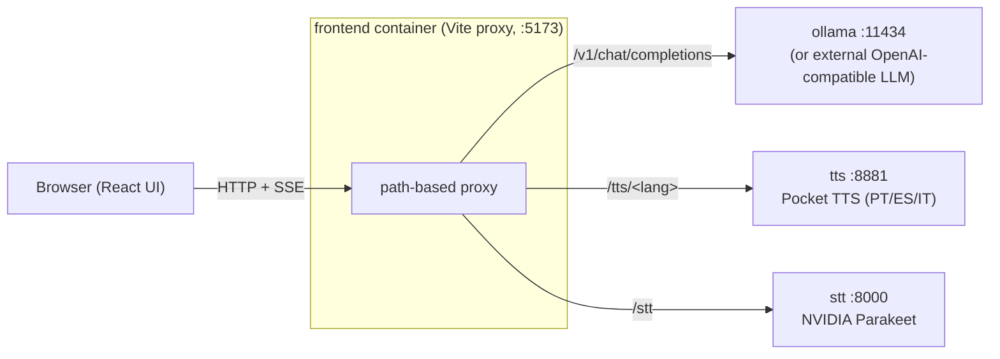

# OpenTandem

A self-hosted language learning app that lets you practice conversation in Portuguese, Spanish, or Italian.
Every message you send gets a streamed AI response, silent background feedback from a grammar teacher, and
a naturalness hint.
And the possibility to run all that locally on your own hardware!

## Features

- **Conversational AI** — streams responses in your target language via Ollama
- **Grammar teacher** — flags errors and explains corrections (respects your punctuation/accent/casing preferences)
- **Naturalness hints** — suggests more fluent phrasing when your sentence sounds awkward
- **Text-to-Speech** — generates audio for AI responses via [Pocket TTS](https://github.com/kyutai-labs/pocket-tts), with auto-play
- **Speech-to-Text** — record your message with the mic button, transcribed by NVIDIA Parakeet
- **English translation** — one-click translation of any AI message
- **Configurable** — toggle each feature on/off; choose whether feedback is given in English or the target language

## Services

| Service    | Role                                        | Default port |
| ---------- | ------------------------------------------- | ------------ |
| `ollama`   | LLM inference (gemma4:e2b)                  | 11434        |
| `tts`      | Text-to-Speech (PT/ES/IT, loaded on demand) | 8881         |
| `stt`      | Speech-to-Text (NVIDIA Parakeet)            | 8000         |
| `frontend` | React/Vite UI                               | 5173         |

## Architecture

The `frontend` container serves the React UI **and** acts as the single gateway the browser
talks to. Its Vite server proxies each path to the right backend (see `frontend/vite.config.js`),
so the browser never contacts Ollama, TTS, or STT directly. The `LLM_API_KEY` is injected
server-side and never reaches the client.



A single LLM endpoint backs four independent roles, each driven by its own system prompt
(see `frontend/src/hooks/useChat.jsx`):

| Role             | Trigger                        | System prompt                               |
| ---------------- | ------------------------------ | ------------------------------------------- |
| Conversation     | every message (streamed reply) | reply in the target language                |
| Grammar teacher  | background, per message        | flag/correct errors, or reply `OK`          |
| Naturalness hint | background, per message        | suggest more fluent phrasing, or reply `OK` |
| Translator       | on-demand (per AI message)     | translate to English                        |

The AI reply is streamed token-by-token (OpenAI SSE); the grammar and naturalness calls run
in parallel in the background and only surface when they find something to say.

## Prerequisites

- [Docker](https://docs.docker.com/get-docker/) with the Compose plugin
- ~8 GB RAM for the LLM container or Ollama on the host (see below)
- A GPU is not required (everything can run on CPU) but is recommended for better performance

## Quick start

### Linux

1. Copy the template env file and edit the paths:

   ```bash
   cp .env.tmpl .env
   # Set OLLAMA_DATA_PATH and HF_HOME_CACHE to writable directories on your machine
   ```

2. Start all services:

   ```bash
   docker compose up
   ```

   On first run, Docker will build the Pocket TTS, STT, and frontend containers. The STT service also downloads
   the Parakeet model (~600 MB) from HuggingFace on first start, and each Pocket TTS container downloads its language model.

3. Pull the LLM model (once the `ollama` container is running):

   ```bash
   docker exec -it ollama ollama pull gemma4:e2b
   ```

4. Open [http://localhost:5173](http://localhost:5173).

---

### macOS

On macOS it is recommended to run Ollama natively (better performance, no virtualization overhead) and use the compose
file for the remaining services.

1. Install and start [Ollama](https://ollama.com), then pull the model:

   ```bash
   ollama pull gemma4:e2b
   ```

2. Start the other services:

   ```bash
   docker compose up
   ```

3. Open [http://localhost:5173](http://localhost:5173).

---

### Running Ollama on the host (Linux)

If you prefer to run Ollama on your host machine instead of in a container, set `OLLAMA_REPLICAS=0` in the `.env` file and point
the URL at the host:

```env
OLLAMA_REPLICAS=0
OLLAMA_URL=http://host.docker.internal:11434
```

The `frontend` service is configured with `extra_hosts: host.docker.internal:host-gateway` so the proxy resolves correctly on Linux.

## Configuration

All options live in `.env` (copy from `.env.tmpl`):

| Variable           | Default               | Description                                                                 |
| ------------------ | --------------------- | --------------------------------------------------------------------------- |
| `OLLAMA_DATA_PATH` | _(required)_          | Host path for Ollama model storage                                          |
| `HF_HOME_CACHE`    | _(required)_          | Host path for HuggingFace model cache (STT)                                 |
| `OLLAMA_URL`       | `http://ollama:11434` | Ollama endpoint seen by the frontend container                              |
| `LLM_URL`          | _(unset)_             | Override to point at any OpenAI-compatible LLM instead of Ollama            |
| `LLM_API_KEY`      | _(unset)_             | Bearer token for `LLM_URL`; injected server-side, never sent to the browser |
| `VITE_LLM_MODEL`   | `gemma4:e2b`          | Model name sent in chat requests                                            |
| `HOST_IP`          | `127.0.0.1`           | IP the frontend binds on. Set to `0.0.0.0` for LAN access                   |
| `OLLAMA_REPLICAS`  | `1`                   | Set to `0` to disable the containerised Ollama                              |
| `TTS_REPLICAS`     | `1`                   | Set to `0` to disable TTS                                                   |
| `STT_REPLICAS`     | `1`                   | Set to `0` to disable STT                                                   |

## Development (without Docker)

Requirements: Node 20+, Python 3.10+, a running Ollama instance.

**Frontend:**

```bash
cd frontend
npm install
OLLAMA_URL=http://localhost:11434 npm run dev
```

**STT service:**

```bash
cd stt
pip install -r requirements.txt
uvicorn main:app --host 0.0.0.0 --port 8000
```

## License

[AGPL-3.0](LICENSE)
